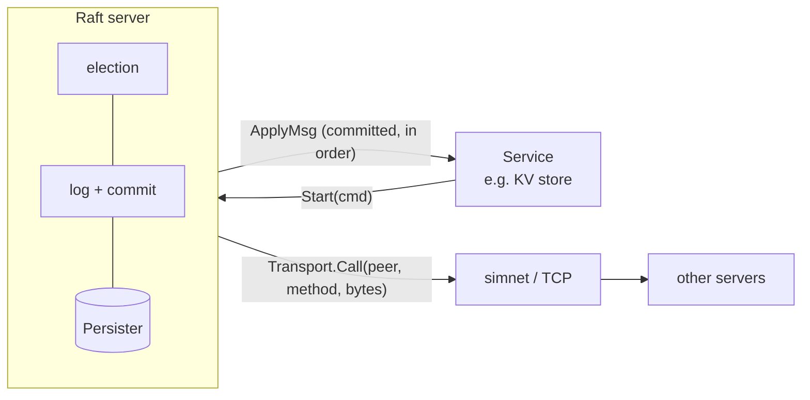

# Raft

A from-scratch implementation of the [Raft consensus protocol](https://raft.github.io/raft.pdf)
in Go, with a fault-injecting network simulator and a test suite that attacks it with leader
crashes, partitions, message loss and reordering.

Raft keeps a replicated log identical across a cluster of servers as long as a majority are up and
can communicate. It is the consensus layer underneath etcd, Consul and CockroachDB.

## Status

| Component | State |
|---|---|
| `simnet`: simulated network (partitions, crashes, drops, delays, reordering) | Done, tested |
| Test harness with a safety checker on every applied entry | Done |
| Stable storage (`Persister`) and RPC codec | Done, tested |
| Leader election: randomized timeouts, term-based voting (§5.2) | In progress |
| Log replication: AppendEntries, fast nextIndex back-off, previous-term commit rule (§5.3, §5.4.2) | In progress |
| Crash recovery: persisting term, vote and log (§5.1) | Planned |
| Log compaction: snapshots and InstallSnapshot (§7) | Planned |
| Linearizable key/value store on top | Planned |

The plan and its milestones are in [ROADMAP.md](ROADMAP.md).

## Design



- **Raft owns encoding; transports only move bytes.** `Transport` is a single
  `Call(peer, method, req []byte)` method. The simulator implements it in tests, and a TCP or gRPC
  transport would be a thin wrapper. Every message really is serialized with `encoding/gob`, so
  accidental memory sharing between servers is impossible, just as on a real network.
- **Failures are first-class.** `simnet` can disconnect servers, partition the cluster into
  groups, crash a process (dropping its in-flight replies and disabling its old sockets), drop 10%
  of messages in each direction, add jitter, and hold replies back for seconds so they arrive far
  out of order. Runs are seeded, and the seed is printed so a failure can be investigated.
- **Safety is checked continuously.** The harness consumes every server's apply channel and fails
  the test the moment two servers commit different commands at the same index, or a server applies
  out of order.
- **Crashes lose memory, not disk.** A crashed server restarts from a copy of its `Persister`, so
  stray writes from the dead instance's goroutines can't leak into its successor.

## Layout

```
raft/          the protocol: types (Figure 2), Raft server, persister, RPC codec
  *_test.go    election, replication, persistence and Figure 8 scenarios + the cluster harness
simnet/        in-memory fault-injecting RPC network
scripts/       stress.sh: run a test pattern N times in parallel, keep logs of failures
```

## Running the tests

```sh
go test -race ./simnet/                      # network simulator
go test -race -run Unit ./raft/              # persister and codec
go test -race -run Election ./raft/          # leader election
go test -race -run Replication ./raft/       # log replication
go test -race -run Persist ./raft/           # crash recovery and Figure 8

RAFT_DEBUG=1 go test -run TestElectionReElect ./raft/   # with protocol traces
```

Concurrency bugs in Raft often show up once in hundreds of runs, so a single pass proves little.
`scripts/stress.sh` runs a pattern many times in parallel and keeps the logs of failed runs:

```sh
scripts/stress.sh -n 200 -p 8 'Election|Replication'
```

## What the tests cover

| Suite | Scenarios |
|---|---|
| Election | initial election, re-election after leader loss, no leader without quorum, 7-node churn, a partitioned leader stepping down |
| Replication | basic agreement, follower failure and catch-up, no commit without majority, concurrent `Start`, a deposed leader with stale entries rejoining, fast back-off over 100-entry divergent logs, the Figure 8 previous-term commit rule driven step by step, RPC count and byte budgets |
| Persistence | full-cluster restart, repeated crashes of leader and followers, Figure 8 with constant leader crashes, Figure 8 on an unreliable network with long reordering |

## References

- Diego Ongaro and John Ousterhout, *In Search of an Understandable Consensus Algorithm (Extended
  Version)*: Figure 2 is the specification this code follows.
- Test scenarios are modeled on the failure cases in the paper and in MIT 6.5840's Raft labs. All
  code in this repository, including the simulator and harness, is original.
